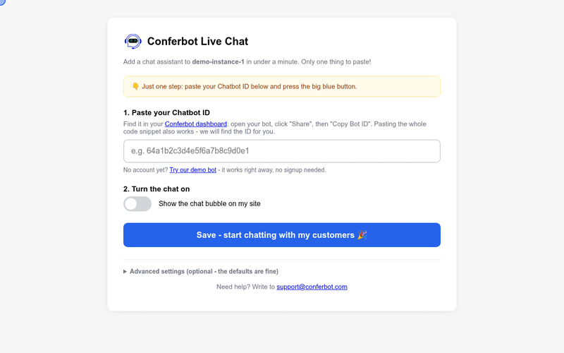

# Conferbot Wix App

Installs the [Conferbot](https://conferbot.com) AI chat widget on a Wix site. Same product as the [Shopify](https://github.com/Conferbot/conferbot-shopify), [BigCommerce](https://github.com/Conferbot/conferbot-bigcommerce), [WordPress](https://github.com/Conferbot/conferbot-wordpress) and [PrestaShop](https://github.com/Conferbot/conferbot-prestashop) integrations, Wix-shaped: OAuth via the Wix installer, and an **embedded script** (registered in the Wix Dev Center from `embedded-script.html`) whose `{{botId}}`/`{{embedType}}` parameters this app pushes per site.

## See it in action

Paste the Chatbot ID in the app settings, save, and the chat is live (recorded against the mock Wix site from the e2e suite):



[HD video (MP4)](docs/demo.mp4)

## How it works

```
user adds the app from the Wix App Market
  -> Wix opens {APP_URL}/auth/start?token=...
  -> we bounce to https://www.wix.com/installer/install (appId + redirectUrl + signed state)
  -> Wix redirects to /auth/callback?code=&state=&instanceId=
  -> state checked, code exchanged at wixapis.com/oauth/access,
     instance confirmed with GET wixapis.com/apps/v1/instance -> tokens stored
  -> redirect to wix.com/installer/close-window to finish the install

site owner removes the app
  -> Wix posts AppRemoved (RS256 JWT) to /webhooks -> record and tokens deleted

merchant saves settings (/app -> /app/save)
  -> app pushes {{botId}}/{{embedType}} via POST wixapis.com/apps/v1/scripts
  -> Wix renders the embedded script (embedded-script.html) on every page
  -> loader boots window.ConferbotWidget(botId, embedType,
       { customData: { platform: "wix" } })
```

The settings page opens only with Wix's signed `?instance=` token (HMAC-verified with the app secret) or the short-lived token from the install, and every save carries a token signed with the app secret; a bare `?instanceId=` is refused. Expired Wix access tokens are refreshed with the stored refresh token, and the embedded script does nothing while the chat is switched off. Everything visitors see is set per bot in the Conferbot dashboard and delivered at runtime, with nothing to configure in the store: flows and AI agents, live chat with handover to your team (queue position, leave a message when nobody is free, read receipts, file sharing, post-chat rating), the home screen, themes and dark mode, colours, launcher and mascot, greetings, languages and disabled URLs.
 The only merchant-facing setting is the **Chatbot ID** (bare ID, full snippet, or URL - auto-extracted), with a one-click **demo bot** (`691c970890527a0468f9b2c9`) that works without a Conferbot account.

## Project layout

```
embedded-script.html   # THE template to paste into the Dev Center Embedded Script component
src/
├── index.js           # entrypoint
├── server.js          # /auth/start, /auth/callback, /webhooks, /app, /app/save, /preview/embedded-script.js
├── config.js          # env config (WIX_INSTALLER_BASE/WIX_API_BASE overridable for tests)
├── wix.js             # instance-token + webhook JWT verify, OAuth token exchange, instance lookup, embed-script push
├── widgetScript.js    # bot ID helpers + local render of the embedded-script html
├── adminPage.js       # two-step settings page
└── store.js           # JSON-file instance store (swap for a real DB)
test/e2e.test.js       # helpers + full journey against a mock Wix + browser widget mount
```

## Install guide

### Requirements

- A Wix site on a **Premium plan with a connected domain**. Wix only runs app embedded scripts on published Premium sites with their own domain; on a free `wixsite.com` address the chat will not appear.
- A Conferbot account and a bot (free plan is fine), or the demo bot to try it first.
- To host the app yourself: Node.js 18 or newer, a public HTTPS URL, and a [Wix Dev Center](https://dev.wix.com) account.

### Install from the Wix App Market

The app is not listed in the Wix App Market yet. Until it is, use the self-hosted app below, or add the embed code by hand: Wix dashboard > **Settings** > **Custom Code** > **+ Add Custom Code**, paste the snippet from Conferbot (your bot > Share > Embed into your website > Wix), place it in **Body - end**, load on **All pages**.

When it is listed: Wix dashboard > **Apps** > **App Market**, search for **Conferbot**, click **Add to Site**, approve the permissions (Manage embedded scripts), and the install window closes. Open the settings from **Apps** > **Manage Apps** > **Conferbot**.

### Install self-hosted (manual)

1. In the [Wix Dev Center](https://dev.wix.com), create an app:
   - **Extensions** > **Embedded Script**: paste `embedded-script.html`, declare the parameters `botId` and `embedType`, placement **Body end**, load on all pages.
   - **OAuth** (legacy custom authentication): App URL `{APP_URL}/auth/start`, Redirect URL `{APP_URL}/auth/callback`.
   - **Permissions**: Manage Embedded Scripts.
   - **Webhooks**: subscribe **App Removed** to `{APP_URL}/webhooks` and copy the **Public key**.
   - **Dashboard page** (or the app's settings URL): `{APP_URL}/app`, so Wix opens it with a signed `?instance=`.
2. Get the code and configure it:
   ```bash
   git clone https://github.com/Conferbot/conferbot-wix.git
   cd conferbot-wix
   cp .env.example .env    # WIX_APP_ID, WIX_APP_SECRET, WIX_PUBLIC_KEY, APP_URL
   npm ci
   npm start               # listens on :3059
   ```
   `APP_URL` must be public HTTPS (a `cloudflared`/`ngrok` tunnel in development). Keep `data/` on persistent storage: it holds each site's tokens and settings.
3. From the Dev Center, **Test your app** on a Premium test site, approve, and open the settings from the site's dashboard.

### Find your bot ID

1. Sign in at [app.conferbot.com](https://app.conferbot.com) and open your bot.
2. Click **Share**, then **Embed into your website**.
3. The bot ID is the 24-character code inside `ConferbotWidget("...")` in the snippet, e.g. `64a1b2c3d4e5f6a7b8c9d0e1`. It is also in the address bar: `.../chatbot/<bot ID>/embed`.

Paste the bare ID, the whole snippet or the dashboard URL; the app pulls the ID out.

### Settings

| Setting | What it does |
| --- | --- |
| **Chatbot ID** | The bot to show. Required before the chat can be switched on. "Try our demo bot" fills a public demo bot. |
| **Turn the chat on** | On/off switch. Off sends an empty bot ID to Wix, and the embedded script then does nothing. |
| **How the chat appears** (Advanced) | Floating chat bubble (`live_chat`, default) or popup window (`popup_chat`). |

Each save pushes the values to Wix (`POST wixapis.com/apps/v1/scripts`). Everything else (flows, AI agent, live chat handover, colours, launcher, greetings, languages, pages to hide on) is set per bot in the Conferbot dashboard.

### Check it works

1. Save with the switch on. You should see "Saved!".
2. **Publish** the site in the Wix editor if you have not since adding the app, then open the live domain in a private window. The chat bubble appears within a few seconds; click it and send a message.
3. The editor preview does not run embedded scripts; always check the published site.

### Troubleshooting

- **No bubble on the live site**: the site needs a Premium plan and a connected domain; check the switch is on and the site has been published.
- **"Saved locally but Wix rejected the embed update"**: the app lost access (removed and re-added, or the permission was revoked). Reopen the app from Manage Apps to reconnect; if it persists, remove and add the app again.
- **"Open Conferbot from your Wix dashboard"**: the settings only open from the Wix dashboard (signed instance, valid for a day). A bookmarked link is refused on purpose.
- **"This settings page has expired"**: the page was open for more than an hour. Reopen it from Manage Apps.
- **Two widgets, or the wrong bot**: remove any Conferbot snippet you added by hand under Settings > Custom Code; the loader skips itself when `conferbot-js` is already on the page, so the hand-added one wins.

### Uninstall

Wix dashboard > **Apps** > **Manage Apps** > Conferbot > **⋮** > **Remove app**. Wix removes the embedded script from the site, and the App Removed webhook deletes the site's record and tokens from this app. Your bot and conversations stay in your Conferbot account.

## Tests

```bash
npm test                    # helpers + install/settings/save journey (mock Wix APIs)
RUN_BROWSER_E2E=1 npm test  # + headless Chrome: the real CDN widget mounts on a mock Wix page
```

15 tests cover: instance-token verification (valid, wrong secret, malformed, stale, other app), installer redirect parameters and state, OAuth code exchange with instance check and close-window, App Removed webhook signature and cleanup, settings rendering via both auth styles, save pushing the exact embed parameters to the Wix API, preview rendering, sanitization of the embedded-script output, and the browser mount.

## Production checklist (before App Market submission)

- [ ] Real database behind the instance store
- [x] App removal webhook (instance cleanup)
- [ ] Wix Dashboard component so settings open inside the Wix admin (#6)
- [ ] Move from legacy custom authentication to Wix OAuth (#6)
- [ ] App Market listing assets (see the submission guide)

## License

MIT.
